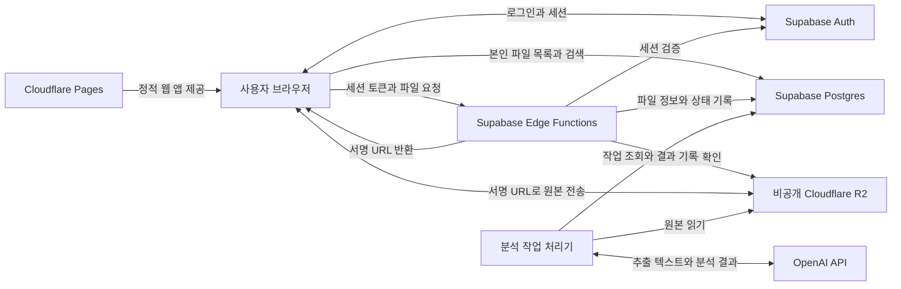

# FileFlicker 구현 계획

목표는 파일을 한 번만 저장하고, 자동 분류·요약·태그로 다시 찾은 뒤 선택한 파일을 내려받는 개인 보관함이다.

로그인 후 파일 목록을 표시한다. 업로드는 별도 화면에서 진행하며 목록으로 돌아갈 수 있다. 파일 상세 모달에서 제목, 요약, 태그를 수정하고 원본 파일명을 확인한다. 요약과 태그는 각각 AI로 생성하고 미리 확인한 뒤 적용한다. 휴지통의 파일은 복구하거나 명시적 확인 후 영구 삭제한다.

AI 생성은 TXT, MD, PDF, DOCX 파일의 텍스트 앞부분을 사용한다. PDF는 앞 5페이지까지 읽고, 텍스트는 최대 20,000자를 전송한다. 목차가 있으면 목차를 중심으로 분석하며, 읽을 수 있는 텍스트가 없으면 OCR 없이 안내한다. 결과는 저장 버튼을 누르기 전까지 수정 중인 내용으로만 유지된다. 기존 분류 데이터는 보존하되 화면과 검색에서 사용하지 않는다.

ChatGPT 연결은 Supabase OAuth 동의를 거치는 읽기 전용 MCP로 제공한다. 파일 검색·상세 조회·텍스트 앞부분 읽기·단기 다운로드 링크만 노출하고, OAuth 토큰의 파일 변경 API 호출은 거부한다. 사용자별 접근은 기존 RLS를 적용한다. PDF·DOCX 내용 추출은 MCP에서 아직 지원하지 않는다.

## 시스템 아키텍처

아래 구성은 구현 목표다. 실제 적용과 검증 상태는 [completed.md](completed.md)에 기록한다.

| 구성 요소 | 책임 |
|---|---|
| 정적 웹 앱 | 파일 선택과 드래그앤드롭, SHA-256 계산, 업로드 진행 표시, 검색·필터, 다중 선택 다운로드 |
| Supabase Auth | 로그인 세션 발급. Edge Function은 세션에서 사용자 ID를 확인한다. |
| Supabase Postgres | 파일명, 소유자, 해시, 크기, R2 객체 키, 요약·분류·태그, 처리 상태 및 분석 작업 기록. 사용자별 해시 유일성 제약과 RLS로 중복 및 접근을 제어한다. |
| Supabase Edge Functions | 업로드 예약·완료 확인, 소유권 검사, 짧은 유효기간의 R2 서명 URL 발급, 메타데이터 변경 |
| Cloudflare R2 | 비공개 버킷에 원본 저장. 객체 키는 파일 이름과 분리하고, 분류는 DB에 기록한다. |
| 분석 작업 처리기 | 제출된 작업을 가져와 원본에서 텍스트를 추출하고 OpenAI 결과를 DB에 저장한다. 가벼운 작업은 Edge Function으로 시작하고, 실행 한도를 넘는 작업은 별도 처리기로 옮길 수 있게 한다. |

### 주요 데이터 흐름

1. **업로드** — 브라우저가 해시를 계산해 예약을 요청한다. 서버는 세션 사용자와 해시를 기준으로 저장 완료된 중복이나 진행 중인 업로드를 확인한다. 새 파일은 DB에 대기 상태로 기록하고 서명 URL을 발급한다. 브라우저가 R2에 직접 전송하면 서버가 크기와 체크섬을 확인하고 완료 처리한다. 중단된 예약은 재시도하거나 만료 처리할 수 있게 한다.
2. **분석** — 분석을 선택한 파일은 업로드 완료 후 작업을 등록한다. 처리기는 텍스트를 추출해 OpenAI에 보내고 요약·분류·태그를 저장한다. 분석이 실패해도 업로드 완료 상태는 유지되며, 재시도는 분석 작업에만 적용한다.
3. **검색 및 다운로드** — 브라우저는 Supabase RLS를 통해 본인 파일 정보를 조회한다. 다운로드 요청에는 선택한 파일 ID를 보내고, Edge Function이 소유권과 업로드 상태를 확인한 뒤 파일별 서명 URL을 발급한다.

브라우저에는 Supabase 공개 키와 사용자 세션만 필요하다. R2와 OpenAI 비밀값은 서버 런타임에서 관리한다. R2 CORS와 로그인 리디렉션에는 로컬 개발 주소와 확정된 배포 주소를 각각 등록한다.

## 구현 순서와 검증 기준

배포는 GitHub Actions에서 `main` 푸시를 기준으로 실행한다. Supabase 파일 API를 배포하고 운영 주소의 사전 요청을 확인한 뒤 Cloudflare Pages에 정적 웹 자산을 배포한다. 초기 저장소 설정은 [README](README.md#자동-배포)에 기록한다.

1. **접근 제어** — Supabase Auth와 기존 파일 테이블의 RLS를 사용한다. 모든 저장 작업은 Edge Function이 검증한 사용자 ID로 범위를 제한한다. 로그인하지 않은 요청과 다른 사용자의 파일 접근이 차단되는지 검증한다.
2. **업로드와 중복 확인** — 드래그앤드롭과 다중 선택을 지원한다. 브라우저에서 SHA-256을 계산하고 사용자별 해시를 조회한다. 새 파일은 제한된 서명 URL로 비공개 R2에 직접 올린다. 서버에서 크기와 체크섬을 확인한 뒤 완료 처리한다. 동시 업로드, 중단 후 재시도, 이름만 다른 중복을 검증한다.
3. **목록·검색·다운로드** — 파일명·요약·태그 검색과 분류 필터, 다중 선택을 제공한다. 서버가 소유권을 확인한 뒤 짧은 기간 유효한 다운로드 URL을 발급한다. 선택한 파일을 브라우저에서 내려받을 수 있는지 검증한다.
4. **자동 분석** — 업로드 완료와 분석을 분리한다. 텍스트와 텍스트가 있는 PDF, DOCX부터 추출기를 적용한다. 사용자가 분석을 선택하면 OpenAI로 요약·분류·태그를 생성한다. 작업 상태와 재시도를 기록하고, 스캔 문서와 지원하지 않는 형식은 원본을 보관한다. 분석 실패 후에도 다운로드가 가능한지 검증한다.
5. **정리·복구** — 분석 결과 수정과 휴지통을 제공한다. 휴지통에 있는 파일을 다시 올리는 경우 기존 파일을 복구하는 흐름을 검증한다.
6. **로컬 통합과 배포** — localhost:5173에서 로그인부터 업로드·검색·다운로드까지 테스트한다. Cloudflare Pages 배포 주소가 확정되면 R2 CORS와 Supabase Auth 리디렉션을 연결하고 운영 주소에서 반복 검증한다. R2와 OpenAI 비밀값은 Edge Functions에서 사용한다.

단계는 검증 근거와 함께 completed.md에 기록한다. 부분 검증 결과에는 검증 범위를 명시한다.

파워포인트는 `.pptx`의 내장 텍스트를 슬라이드 순서대로 읽어 기존 AI 요약·태그 생성에 사용한다. 앞 5장을 우선 읽고 텍스트가 부족하면 최대 10장까지 읽는다. 구형 `.ppt`, 이미지 속 글자 인식과 OCR은 후속 범위다.

### OCR 도입 계획

1. **첫 지원 범위** — 파일 상세에서 사용자가 요약 또는 태그의 **AI 생성**을 눌렀을 때 JPG·JPEG·PNG와 스캔 PDF를 읽는다. PDF는 기존대로 앞 5페이지의 내장 텍스트를 먼저 확인하고, 읽을 만한 텍스트가 부족한 페이지만 최대 3장 OCR 대상으로 삼는다. 일반 텍스트 PDF와 PPTX의 기존 처리 경로는 유지한다. PPTX 이미지, 일괄 처리, 전체 본문 검색은 후속 단계로 둔다.
2. **처리 흐름** — 브라우저는 기존 서명 URL로 원본을 읽고 PDF 페이지의 공백 제외 텍스트가 40자 미만이면 Vision 입력용 이미지로 렌더링한다. 파일 API는 로그인·소유권을 검사한 뒤 추출 텍스트와 제한된 수의 이미지를 OpenAI에 보내 요청한 요약 또는 태그를 한 번에 생성한다. 정확한 원문 추출이나 본문 검색이 필요해지면 전용 OCR을 검토한다.
3. **결과와 실패** — 기존 AI 버튼의 진행 표시와 결과 미리보기를 사용한다. 읽을 수 있는 텍스트가 없거나 요청이 실패하면 화면에 이유를 안내하고 기존 제목·요약·태그를 유지한다. 원본은 비공개 R2에 유지하고, 첫 버전에서는 OCR 이미지와 인식 본문을 별도로 저장하지 않는다.
4. **검증과 배포** — 한글·영문 혼합 이미지, 일반 PDF, 스캔 PDF, 내장 텍스트와 스캔 페이지가 섞인 PDF, 흐리거나 빈 이미지를 합성 표본으로 확인한다. OCR 호출 범위, 처리 시간, 요청당 비용, 실패 시 기존 값 보존, 권한 없는 요청 차단을 검증한다. 운영 배포 전에 표본 결과로 품질을 판단한다.

파일당 업로드 한도는 50 MB 미만(50,000,000바이트 미만)이다. 화면은 해시 계산 전에 크기를 확인한다. 한도를 넘는 파일은 파일명과 크기를 표시하고, 이미지는 압축, 문서는 필요한 부분을 분할해 다시 선택하도록 안내한다. 여러 파일 중 조건을 충족한 파일은 계속 업로드한다. 서버에서도 동일한 기준을 적용한다.

새 업로드는 TXT, MD, PDF, DOCX, PPTX, JPG, JPEG, PNG의 8개 확장자만 허용한다. 선택 버튼과 드롭 영역 가까이에 허용 목록과 크기 제한을 표시한다. 브라우저는 해시 계산 전에 검사하고, 서버는 업로드 예약과 완료 시 검사한다. 구형 PPT에는 PPTX 변환을 안내한다. 이미 업로드한 파일은 확장자에 관계없이 조회하고 다운로드할 수 있다.

브라우저는 R2의 `pending/` 경로로 직접 업로드한다. 함수는 저장된 파일의 SHA-256을 계산하고, 검증한 객체 버전만 최종 경로로 복사한다. 최종 경로에는 업로드 URL을 발급하지 않는다. 배포 전 한도 바로 아래의 파일은 처리되고 한도에 도달한 파일은 거부되는지 확인한다. 임시 객체 만료 정책과 중단된 예약 정리 작업을 연결한다.
